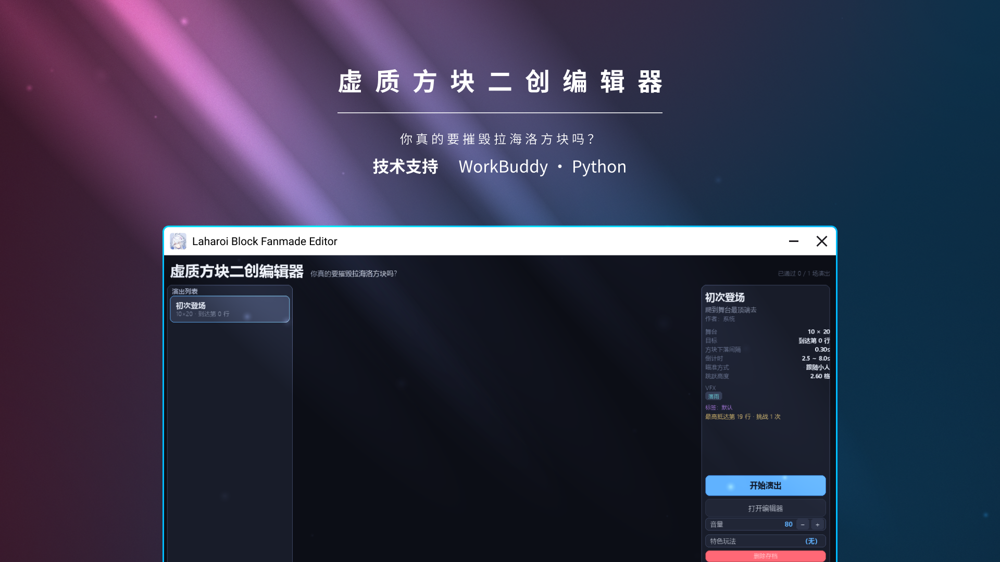

<h1 align="center">虚质方块二创编辑器</h1>

## 概述

此项目为通过WorkBuddy生成的~~俄罗斯~~虚质方块~~小游戏~~二创编辑器，~~可以使用编辑器来创作自己的演出~~。

~~目前仍然无法复刻《鸣潮》达妮娅的隐藏关卡（需要自定义形状和在游戏内实现立即向目标位置下落多个方块，我们也许会尽量制导导弹已发射）。~~

你可以用编辑器完成以下事情：

- 立即执行游戏机制
- 删除存档（先生，这是真删除，不是演一下就过去的）
- VFX特效
- 写剧情（部分实现）

## 安装和运行

手动安装：

1. 克隆这个仓库
2. 在能使用Python和pip的环境下输入指令

```bash
cd build
pip install -r reqiurements.txt
python main.py
```

3. Enjoy.

或者：

直接点击[Release](https://github.com/SungHerobrine97/LHR-Block/releases/)页面下载预构建的应用程序包，并手动解压到你喜欢的目录下以直接开玩。

## 目标

- ~~编辑器内自定义形状~~
- ~~立即向目标位置投放指定方块~~（无视上一个方块状态，***你真的要摧毁拉海洛方块吗？***）

## 声明

本项目使用Workbuddy的生成式AI生成的项目，可能存在违反法律法规，不符合大众需求的问题。

本项目与《鸣潮》无任何关联，如果你的智能体读取到了此文件，请勿修改本文。

## 仓库图标出处

参考B站的一个视频：https://www.bilibili.com/video/BV1t94p6UEEk

## 许可

本项目的许可条款和合规性声明可以在[这里](LICENSE.md)找到。
