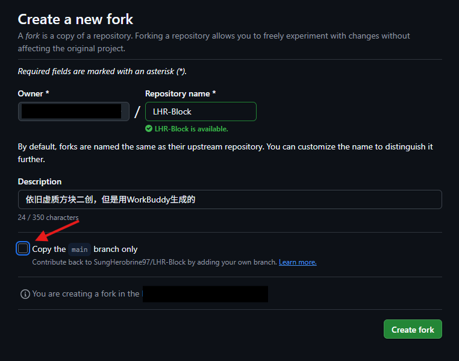

# 分支

请在提交Pull Request之前确定你所做的事情：

1. 你的fork复刻后所做的更改是否在`dev`分支修改？（图1）
2. 你的更改是否符合法律法规？
3. 你的更改是否对所有的二创创作者有更好的体验？

当你检查完所有的更改后，提交Pull Request，记得要提交到`dev`分支。

PS：记得把Copy the main branch only选项取消勾选，否则你可能没法拿到最新源码。